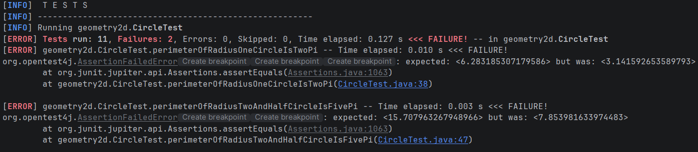
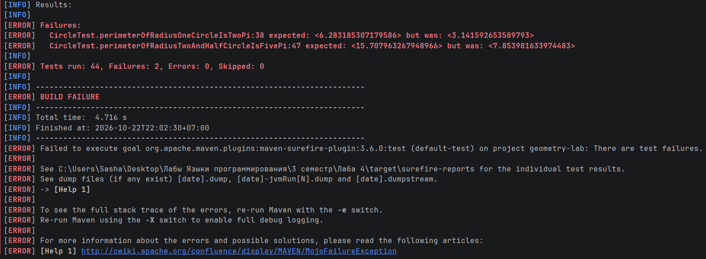
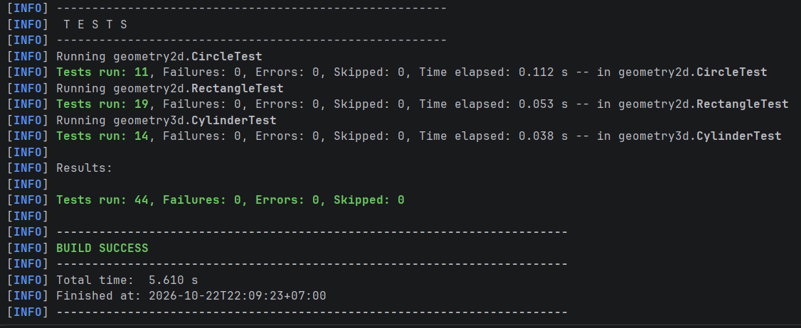

# Лабораторная работа № 4. Сборка проекта с Maven и модульное тестирование с JUnit

## **Автор:** Пустозёрова Александра Дмитриевна
## **Группа:** ФИТ-251

## Структура проекта

```text
java-labs/
├─ .mvn/
│  └─ wrapper/
│     └─ maven-wrapper.properties
├─ src/
│  ├─ main/
│  │  └─ java/
│  │     ├─ app/Main.java
│  │     ├─ geometry2d/
│  │     ├─ geometry3d/
│  │     ├─ exceptions/
│  │     └─ storage/
│  └─ test/
│     └─ java/
│        ├─ geometry2d/
│        │  ├─ CircleTest.java
│        │  └─ RectangleTest.java
│        └─ geometry3d/
│           └─ CylinderTest.java
├─ data/
├─ pom.xml
├─ mvnw
├─ mvnw.cmd
├─ README.md
└─ .gitignore
```

## Сборка, тестирование и запуск

Запуск тестов:

```bash
./mvnw.cmd test
```

Очистка, компиляция, запуск тестов и сборка JAR:

```bash
./mvnw.cmd clean package
```

Запуск программы (аргументы: входной текстовый файл, выходной бинарный файл):

```bash
java -jar target/geometry-lab.jar data/figures.txt data/figures.bin
```

Запуск программы без аргументов (пути запрашиваются у пользователя):

```text
java -jar target/geometry-lab.jar  
```

## Проверка обнаружения ошибки:

В классе Circle была внесена ошибка в методе perimeter: Math.PI * radius вместо 2 * Math.PI * radius


----------------------


После исправления ошибки:

